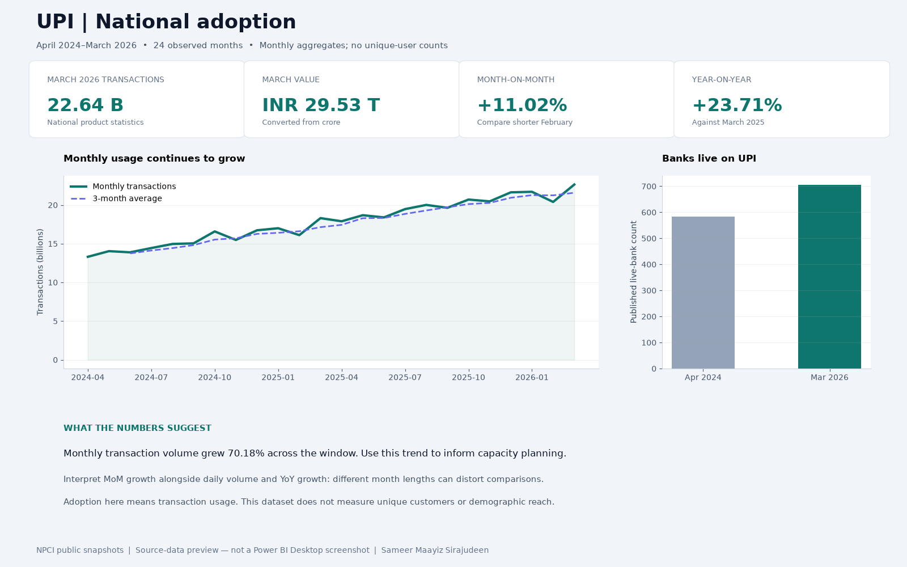
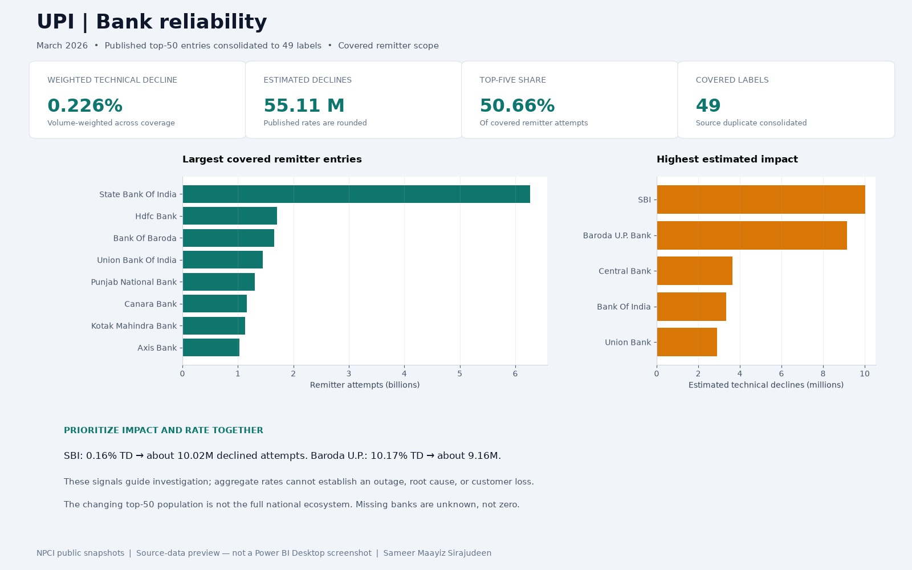
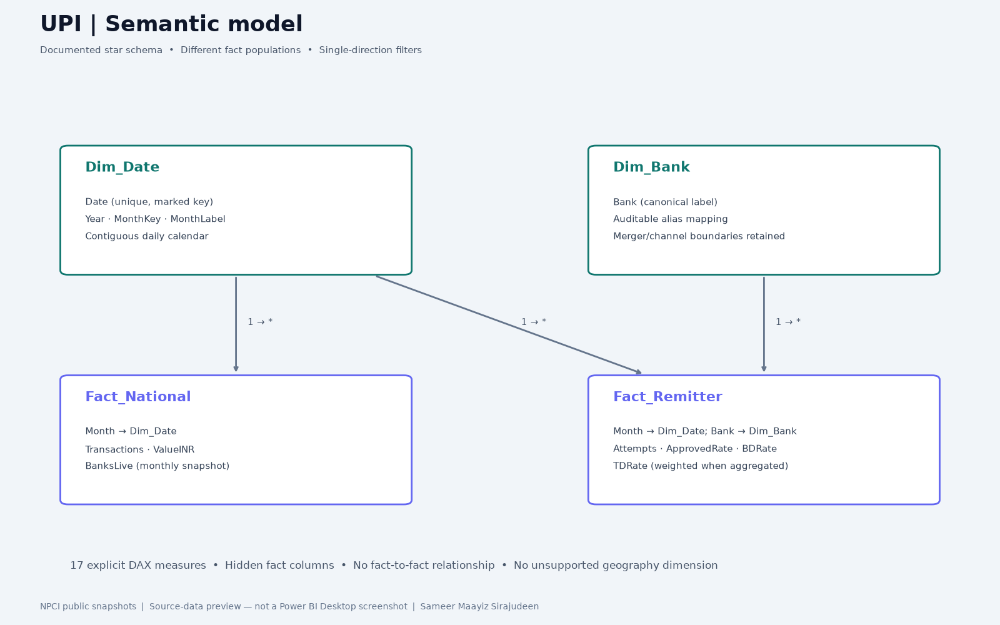

# UPI Payments — Adoption & Reliability

A Power BI portfolio project by Sameer Maayiz Sirajudeen. PBIP + PBIR + TMDL source files, public NPCI snapshots, explicit DAX measures, and repeatable data checks.

**Status:** Source implementation completed; Power BI Desktop refresh/render and Service publishing are pending. This package was built on Linux without Power BI Desktop. PNGs below are source-data previews, not screenshots of a running Power BI report. No live report URL is claimed.

## Problem
How has India's UPI usage grown, and which covered remitter banks contribute most to technical declines? A high decline percentage and a high number of affected attempts answer different operational questions.

## Method
- Official NPCI public statistics feeds; April 2024–March 2026, captured October 7, 2026. The originally proposed data.gov.in bank-level resource could not be verified.
- 24 national monthly records and 1,200 published remitter rows (50 entries each month), consolidated into 1,199 bank-month records.
- Power Query trims strings, parses comma-separated numbers and percentages, fixes dates, applies an auditable bank alias table, and converts millions/crores to transactions/INR.
- Two fact tables with different populations: national product transactions/value and covered remitter attempts/rates. Never add them together or reconcile them as identical populations.
- Conformed daily date dimension and bank dimension; single-direction relationships; date key metadata; hidden fact columns; 17 explicit measures with display folders and formats.
- Two report pages keep national KPIs separate from bank slicers. Weighted rates use `SUMX(attempts × rate) / SUM(attempts)`.

## Findings from the captured data
- National monthly volume rose **70.2%**, from April 2024 to March 2026; this is transaction usage, not a count of unique users.
- March 2026 recorded **22.64 billion** transactions, **11.02% MoM** and **23.71% YoY** growth. Consider February's shorter month; daily volume is included for context.
- The March covered-bank weighted TD rate was **0.226%**, equivalent to approximately **55.11 million** declined attempts. Counts are estimates from rounded published percentages.
- The five largest covered remitter entries account for **50.66%** of March covered attempts; this is not national market share.
- SBI's 0.16% TD rate implies about 10.02 million declined attempts; Baroda U.P. Bank's 10.17% implies about 9.16 million. Prioritize both impact and rate, then investigate causes outside this aggregate dataset.

## Business use
Supports capacity planning and reliability triage: track usage, distinguish technical declines from business declines, and identify banks for further investigation. It does not establish root cause, losses, savings, outages, or an improvement caused by this dashboard.

## Open locally (Windows)
1. Extract this whole folder. Install current Power BI Desktop; enable PBIP/PBIR features if your release requires them.
2. Run `python scripts/configure.py` from this folder to set your local data path. Alternatively edit `DataRoot` in `UPI-Payments.SemanticModel/definition/expressions.tmdl` or in Power Query Manage Parameters.
3. Open `UPI-Payments.pbip`, then Refresh. Use Import mode and a local-file privacy setting suitable for public data.
4. Verify the date table is marked with `Dim_Date[Date]`, visual roles render correctly, and bank/month slicers affect only their intended page. Desktop validation is required before claiming a finished published report.
5. Check the March 2026 reference values above. Save as PBIP; keep `.pbix` out of Git.

See [Desktop acceptance checks](docs/desktop-acceptance.md), [data dictionary](docs/data-dictionary.md), [measure definitions](docs/measures.md), and [source notes](docs/source-notes.md).

## Previews
These are independently rendered views of the captured CSV data. Replace them with real Desktop screenshots after completing the acceptance checks.





## Reproduce and validate
Python 3.10+; the data/build scripts use the standard library.

```sh
python -m unittest discover -s scripts -p 'test_*.py'
python scripts/validate_data.py
# Optional network refresh; review changed schemas and bank aliases before rebuilding.
python scripts/fetch_data.py
python scripts/build_project.py
python scripts/configure.py
```

`python scripts/validate_schema.py` checks 26 files against Microsoft’s published JSON schemas. The GitHub Actions workflow runs data and schema checks.

`build_project.py` regenerates report/model source, validates the fixed snapshot before writing outputs, and preserves the configured DataRoot. `configure.py` is a local setup step; review the path before committing. Previews require matplotlib. JSON schema checks require jsonschema and network access on the first run; schema files are cached outside Git.

## Publish and portfolio
GitHub destination requested: `smagen12`. No remote push has been made. The connected account during preparation was `smagen10`.

Power BI Service URL: **pending**. Publish from Desktop after validation, then add screenshots, the actual Service URL if shareable, and the GitHub URL. The project contains public aggregate data; follow source terms and your tenant's sharing policy. Do not add credentials.

Suggested CV line after Desktop validation: “Built a Power BI UPI analytics dashboard with Power Query, a two-fact star schema, 17 DAX measures, and volume-weighted decline analysis across 1,199 bank-month records.”

Naukri skill after hands-on validation: `Power BI (DAX, Power Query, data modeling)`.

## Rights
Original project code is MIT licensed. NPCI source data belongs to its source owner; the code license does not grant rights over the data. Source attribution and links are included; review NPCI terms before redistribution or public hosting.
